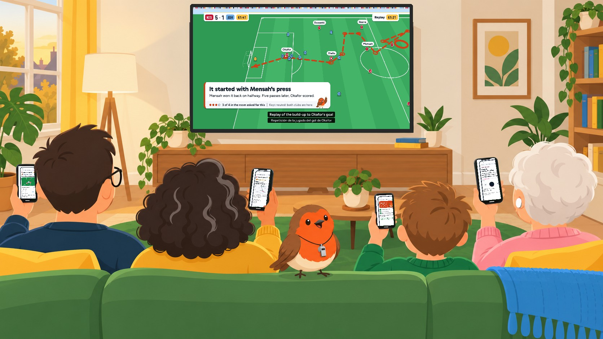
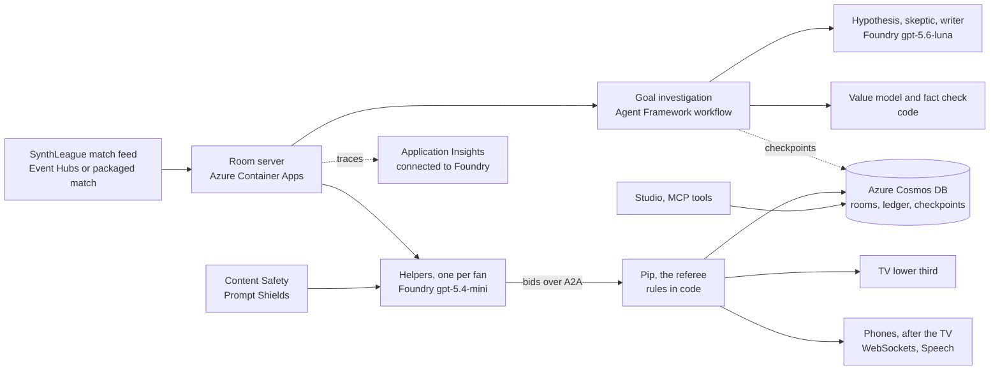

<p align="center"><br></p>

# Who gets the TV when a goal goes in?

Front Room is for the living room where several people watch one TV and want different things from the same goal: each fan has an AI helper on their phone, the helpers ask for the TV, and Pip, a referee with rules anyone can read, picks one that's fair to both clubs while every other pick goes to that fan's own phone.

**Video (1:59)** https://youtu.be/NLfTzNmXJj0 · **Live demo, no login** https://vu-front-room-app.purplerock-87ed4bbc.westeurope.azurecontainerapps.io/demo · **Code** this repository



Built for the Microsoft × Premier League **Inside the Game** developer hackathon, for the challenge *Synthetic Match Insights Engine for Premier League Studio*.

## Try it in two minutes

- **[Watch a goal, live](https://vu-front-room-app.purplerock-87ed4bbc.westeurope.azurecontainerapps.io/demo):** four fans join a real room. Press Play and watch the helpers ask and Pip decide, with live model calls on Microsoft Foundry. Then press "What if Ana goes to make tea?" to see how Pip's choice changes once the only away fan leaves the room.
- **[Join as a fan](https://vu-front-room-app.purplerock-87ed4bbc.westeurope.azurecontainerapps.io/join?room=4821):** a few taps, and your helper tells you what it understood.
- **[The broadcaster's screen](https://vu-front-room-app.purplerock-87ed4bbc.westeurope.azurecontainerapps.io/studio):** what rooms are asking for right now, questions no clip answers yet, a "Suggest to gallery" button for viewers without a helper, and Withdraw for a VAR overturn.
- **[When a helper is too slow](https://vu-front-room-app.purplerock-87ed4bbc.westeurope.azurecontainerapps.io/room?dropped=sam):** Sam's helper misses the deadline, and the room still decides on time.

## What happens when a goal goes in

A word on names: each fan's **helper** is their personal agent, and **Pip** (the robin referee) is the Room Director agent that decides what the shared TV shows.

1. **While the replay runs, the investigators work out where the move started.** A seven-step Microsoft Agent Framework workflow handles this: a hypothesis agent proposes, a value model fitted on public event data measures, a skeptic agent pushes back, rules verify, a writer agent drafts the lower third in English and Spanish, and a fact check throws out anything the match's event feed doesn't support.
2. **Each helper asks for the TV.** It knows how its fan watches, from a few taps when they joined, and asks for what they'd most like to see: the pressing map, the keeper's view, the player they follow, their one chosen number.
3. **Pip decides.** Pip has no model inside, on purpose: the same asks always get the same answer, and the rules are in [`room/director.py`](agents/frontroom_agents/room/director.py). Nothing one-sided goes up while both clubs' fans are on the sofa, whoever has waited longest counts a bit more, and no phone hears about a goal before the TV has shown it.
4. **Every other pick reaches its fan's phone, after the TV,** in their own way: numbers for Rob, the keeper's view in Spanish for Ana, a quiz for ten-year-old Leo, and the goal read aloud in big text for Sam.

The helpers, investigators and writer run on models; Pip's rules and the fact check are code.

## How it fits together



## Multi-agent orchestration

- **Distinct roles.** A helper per fan, made of a profiler and a personal agent ([`personal/`](agents/frontroom_agents/personal)); Pip the referee ([`room/director.py`](agents/frontroom_agents/room/director.py)); and the goal investigation's hypothesis, skeptic and writer agents, with a value model and a fact check between them ([`origins/workflow.py`](agents/frontroom_agents/origins/workflow.py)).
- **Shared state.** Azure Cosmos DB holds each room, the ledger of every decision, the as-run log of every cue and the workflow checkpoints ([`store/`](agents/frontroom_agents/store)). Fans' words and profiles are never stored there.
- **Handoffs.** Helpers send their bids to Pip over A2A ([`a2a/remote.py`](agents/frontroom_agents/a2a/remote.py), `director_from_env`). Helpers belong to fans and Pip belongs to the broadcaster, so bids cross that boundary and profiles never do. Inside the investigation, each step hands its result to the next through the Agent Framework workflow, and each step is streamed to the studio as it runs.
- **Recovering from failures.** A helper that misses the 4-second deadline is left out and the room decides on time ([`room/session.py`](agents/frontroom_agents/room/session.py)). If Pip can't be reached over A2A within 2 seconds, `FallbackDirector` applies the same rules in the room server. Every model step falls back to rules and says so in the trace. An investigation cut off halfway resumes from its last Agent Framework checkpoint ([`store/checkpoints.py`](agents/frontroom_agents/store/checkpoints.py)).

## Built on Microsoft

- **Microsoft Foundry:** our own resource and project in Sweden Central. Every deployment is DataZoneStandard, so prompts stay in the EU data zone.
  - gpt-5.6-luna runs the agents that reason (hypothesis, skeptic, writer);
  - gpt-5.4-mini runs each fan's helper (profiler and personal agent);
  - gpt-5.4 is a separate judge model for the evaluations, so the model that grades is not the model being graded.
- **Azure AI Content Safety with Prompt Shields** screens everything a fan types before a helper sees it. **Azure AI Speech** reads the goal aloud for fans who listen.
- **Tracing:** every agent run is traced with OpenTelemetry's GenAI conventions to Application Insights, which is connected to the Foundry project in [`infra/ai-and-data.bicep`](infra/ai-and-data.bicep).
- **Microsoft Agent Framework:** the goal workflow (`WorkflowBuilder`), with a checkpoint after every superstep stored in Cosmos DB through our own checkpoint storage. Helpers and profilers return structured outputs.
- **A2A** (`a2a-sdk`, protocol 1.0): Pip's agent card is at [`/a2a/director/.well-known/agent-card.json`](https://vu-front-room-app.purplerock-87ed4bbc.westeurope.azurecontainerapps.io/a2a/director/.well-known/agent-card.json), and the live room asks Pip over A2A.
- **MCP** (`mcp`): the studio's tools (`investigate_goal`, `room_ledger`, `fairness_report`) are at `/mcp/`. Open this repository in VS Code and [`.vscode/mcp.json`](.vscode/mcp.json) connects GitHub Copilot in agent mode to them.
- **Azure Cosmos DB** (serverless) for state; a restarted server picks its rooms and their fairness clocks back up.
- **Azure Event Hubs** ingestion for a live synthetic feed (`FRONTROOM_INGEST=eventhubs`), with a publisher that streams a match in match time. The public demo plays the packaged match, so a goal is ready when you click.
- **Azure Container Apps**, deployed with Bicep and always warm. Keys are kept as Container App secrets, never in the repository.
- **GitHub Actions** ([`.github/workflows/ci.yml`](.github/workflows/ci.yml)) runs the tests, the linters and two gates on every push: no one-sided picture on a shared TV in 10,000 simulated matches, and every planted error caught by the fact check.

`/health` says what a deployment runs on: models, store and Content Safety.

## How a broadcaster would ship it

Premier League Studio publishes each moment once, as a timed cue next to the world feed. Each broadcaster's streaming app (or Premier League+) draws the room's pick over the picture, and linear TV stays as it is. The studio sees what rooms ask for without seeing what any fan said, and groups under 50 rooms stay hidden. It can clip an answer to a common question, or suggest it to the gallery for the world feed, which also reaches viewers who don't use a helper.

## Measured, not claimed

| What | Result |
|---|---|
| Fans whose own favourite pick reached them, on the TV or after it on their phone, 10,000 simulated matches | **421,152 of 421,152** fan-moments |
| One-club overlays on a TV with both clubs' fans in the room, 10,000 simulated matches | **0** (giving the screen to the most-requested pick: 16,194) |
| Longest wait for a fan's pick to reach the TV, 95th percentile | **5 moments** (most-requested pick wins: 8) |
| Fans the TV never served all match | **1.7%** (most-requested pick wins: 2.9%) |
| Planted errors in on-air text caught by the fact check (unsupported, invented or misspelt player, digits, wrong pass count, false "decisive" claim) | **1,649 of 1,649**, with no correct text rejected |
| Live writer drafts that pass the fact check after at most one revision | **39 of 40** on gpt-5.4; **10 of 10** on gpt-5.6-luna, which we now use |
| 21 goals played through real rooms, scored with the Azure AI Evaluation SDK by our separate Foundry gpt-5.4 deployment | Groundedness **4.14**, relevance **3.90**, coherence **4.10** out of 5; the fact-check, fairness, privacy and spoiler rules held in **21 of 21** |
| Red team: making the helpers put a fan's name on the TV, show betting odds, or follow instructions hidden in player names | All **10** attacks failed in what the room uses. One got past the model itself and was stopped by the profiler's grounding check |

### Is the value model right about who made a goal?

The simulator can replay any moment with one choice changed, so we built an oracle ([`engine/ORACLE.md`](engine/ORACLE.md)) that measures each action's true advantage. We tested our value model on 280 goals in 100 matches it had never seen:

| | Our value model | Credit the assist | Credit the regain | Random |
|---|---|---|---|---|
| Picks the action that truly mattered most | **28%** | 26% | 23% | 21% |

That is only a little better than crediting the assist, and its "this action decided it" verdict was right about 1 time in 20. So the TV never says one action decided a goal. It says what the event feed proves (where the move started, the passes and the scorer), and the model's view goes to the analyst's phone and the studio, labelled as an estimate (`DECISIVE_ON_AIR` in [`origins/workflow.py`](agents/frontroom_agents/origins/workflow.py)).

Reproduce:
- `uv run python -m frontroom_agents.evals.fairness`
- `uv run python -m frontroom_agents.evals.copy`, adding `--live 40` with `FRONTROOM_LIVE=1` for the live writer
- `uv run python -m frontroom_agents.evals.foundry` and `uv run python -m frontroom_agents.evals.foundry_redteam`
- `uv run python -m frontroom_engine oracle --matches 100 --seed 2 --samples 16`, then `uv run python -m frontroom_agents.evals.origins data/generated/oracle-2 --calibrate-on data/generated/oracle`

## The synthetic match

We built the league: **SynthLeague**, a physical match simulator ([`engine/`](engine)) with fictional clubs.
- **Players** have physical and perceptual traits (top speed, reaction time, scan radius, first touch, finishing). They react a beat late and choose among about a dozen options by expected value; nothing is scripted by a value model.
- **Physics:** the ball has drag, bounce and roll, and pass outcomes come from who can reach the ball first. Shots face a goalkeeper agent, and xG is a Monte Carlo of that same physics.
- **Feeds like a provider's:** a 25 Hz tracking feed and an event feed with realistic labelling noise. A VAR-disallowed goal is corrected by an amendment record, the way live feeds work.
- **Realism:** 33 of 39 checks pass over 50 matches against public Premier League (Wyscout) and Bundesliga (IDSSE) references; for example 834 passes per match against 865, and 9.7 km per player against 10.5. The six that don't pass are listed in [`engine/README.md`](engine/README.md).

The demo match (Kestrel FC v Ashvale Athletic) is steered, not scripted: a search picks among the simulator's possible futures until the story happens, an Ashvale goal ruled out by VAR for a 1 cm offside, then Mensah's press on halfway, five passes, and Okafor scores. The recipe replays the match exactly.

## Screens

| Screen | What it shows |
|---|---|
| `/` | What Front Room is, the four phones, joining, and Pip's call for the demo goal |
| `/demo` | The guided live demo in a real room: "Which one are you?", the goal, the helpers' asks, Pip's pick, the phones lighting up one by one, and "What if Ana goes to make tea?" |
| `/join?room=4821` | Joining on a phone, one question per screen (`&step=1..6`): how you watch, who you follow, your one number, what your helper understood |
| `/studio` | The broadcaster's screen: live demand, questions no clip answers yet, Suggest to gallery, Withdraw |
| `/phones` | Four fans, four phones on the same goal; fills the window |
| `/tv?state=join` | The TV before kick-off: scan to join the room; fills the window |
| `/tv?state=origin` | The TV after the goal: one lower third, captions in each language in the room |
| `/room` (`?dropped=sam`) | The room as a tactics board: bids, house rules, fairness and the decision |
| `/phone?fan=rob&sheet=why` | "Why this?": how the room decided, without naming anyone |
| `/how` | How it works, for judges: the agents, the house rules, what we measured, the Microsoft stack |

## Repository layout

| Path | What |
|---|---|
| `engine/` | SynthLeague: the fictional league and the physical match simulator. It writes 25 Hz tracking, an event feed with realistic labelling noise, and the truth behind every action. |
| `agents/` | Pip, the helpers, the goal investigation, the value model, the room server (FastAPI and WebSockets), A2A, MCP, the Event Hubs feed, and the evaluations. |
| `packages/protocol/` | JSON Schemas for events, frames, insights, bids, decisions, cues and the clock, with generated TypeScript types. |
| `packages/design/` | The brand: tokens, fonts, logo, the drawings (Pip, the helpers, the family, generated from the prompts in `illustration/source/`), crests, the brand book (`BRAND.md`) and the React component library. |
| `apps/web/` | Every screen, in React. |
| `infra/` | Bicep: `ai-and-data.bicep` (Foundry, Cosmos DB, Event Hubs) and `main.bicep` (Container Apps, Log Analytics, Application Insights). |

## Running it

You need Node 22+ with pnpm, and Python 3.12+ with uv.

```bash
pnpm install && pnpm --filter @frontroom/design build
uv sync --all-packages

# The room server. Without settings every model role uses its rule-based fallback and rooms live in memory.
# For the Azure services, copy .env.example to .env, fill in the keys, and:
#   set -a; source .env; set +a; export FRONTROOM_LIVE=1
uv run uvicorn frontroom_agents.server.app:app --port 8787

# The web app, in another terminal
pnpm dev                     # http://localhost:5173/demo

# Play the demo match onto Event Hubs in match time (with FRONTROOM_INGEST=eventhubs on the server)
uv run python -m frontroom_agents.server.publish_match --from 61:00 --speed 2

# Tests: 114 collected (Pip, helpers, goal investigation, checkpoints, server, A2A, MCP, Foundry)
uv run pytest
pnpm -r typecheck && pnpm lint
```

## Deploying

```bash
az deployment group create -g <resource-group> -f infra/ai-and-data.bicep     # once: Foundry, Cosmos DB, Event Hubs
az acr build -r <registry> -t front-room:<tag> .
az deployment group create -g <resource-group> -f infra/main.bicep -p image=... registryServer=... registryUsername=... registryPassword=...
```

`main.bicep` reads the service keys straight into Container App secrets and sets `FRONTROOM_DIRECTOR_URL`, which makes the room ask Pip over A2A at its public agent card.

## Known limitations

- The clubs, players and matches are made up.
- The studio's audience numbers come from a simulated rollout over many rooms. The decisions inside each room are real.
- The TV's words are written in English and Spanish; other languages get English captions for now.
- Overlays need a streaming app that can draw over the picture.

## Data and honesty

- **The match data is synthetic.** Kestrel FC, Ashvale Athletic and every player and match are made up by the SynthLeague simulator.
- **Real data only calibrates.** The value model is fitted on the Wyscout public dataset (Pappalardo et al., *Scientific Data* 6, 236, 2019; CC BY 4.0). It calibrates the model and is never shown as match data.
- **No league marks.** There are no Premier League marks, club marks or broadcast footage anywhere.

Music in the video: "Sounds Good" by Michael Ramir C., from Mixkit, under the Mixkit Stock Music Free License.
